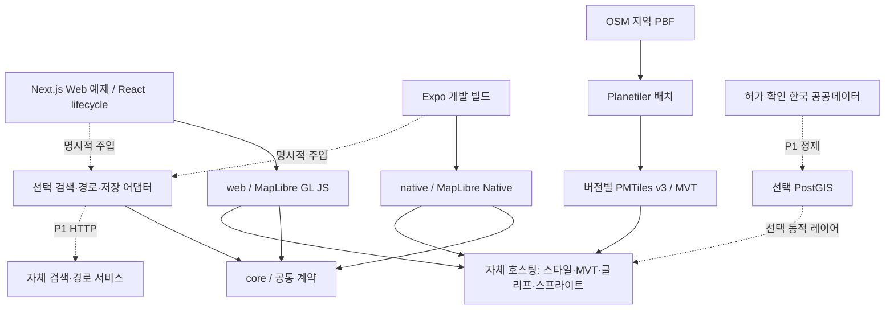

# Korea Map Kit 기술 아키텍처

설계 기준일: 2026-10-19. 상태: 구현 전 설계. [정책](../AGENTS.md), [요구사항](requirements.md), [로드맵](roadmap.md), [조사 근거](research/technical-review.md), [검증 기록](research/design-validation.md)을 함께 읽는다. 아래 패키지명은 npm 예약·발행 여부가 확인되지 않은 가칭이다.

## 1. 결정 요약과 MVP 경계

MapLibre GL JS(Web)와 MapLibre Native를 감싼 MapLibre React Native(Android/iOS)를 사용한다. TypeScript 코어는 좌표·카메라·피처·오류·서비스 계약을 공유하고, 렌더러 객체 및 플랫폼 UI는 공유하지 않는다. Next.js와 Expo는 예제 앱의 선택이며 SDK 사용자의 필수 프레임워크가 아니다. [ADR-001](decisions/001-renderers-and-platforms.md)

**MVP는 M1~M4의 합이다.** M1은 공통 계약과 모바일 호환성 확인, M2는 Web SDK, M3는 한국 지역 타일·한글 스타일·자체 호스팅, M4는 Android/iOS 실제 동작 검증이다. Web만 완성된 상태는 Web preview이며 전체 MVP가 아니다. 범위는 대한민국 내 명시한 시범 지역 한 곳부터 시작하고 전국 상세도·주소 완전성은 보장하지 않는다.

MVP에 포함: 지도, 한국어 라벨, 카메라, 마커·GeoJSON·선/면, 피처 선택, 스타일 교체, 출처 표시, 사용자 소유 스타일/타일, 유료 키 없는 자체 호스팅, 검색/경로 인터페이스 및 명확히 표시된 fixture 예제. 실제 검색/경로 엔진, 공공데이터 대량 통합, 계정, Supabase, 오프라인 다운로드, 3D 지형, 실시간 교통, 내비게이션은 P1/P2다. **경로 선을 그리는 기능과 길찾기를 계산하는 서비스는 별개다.**

## 1.1 Zero Publisher Cost와 Provider 설정 계약

[ADR-009](decisions/009-zero-publisher-cost.md)와 [비용 감사](cost-audit.md)를 모든 패키지·데모·도구에 적용한다. SDK 설치/import/기본 테스트가 제작자의 API 키·DB·타일 서버·백엔드·유료 계정으로 요청하지 않게 설계한다. 무료 계정의 quota도 제작자 공유 자원이며 기본값으로 사용하지 않는다.

지도 입력은 다음 중 하나를 명시적으로 선택한다. 아래는 구현 예정 계약이며 런타임 검증 완료를 의미하지 않는다.

```ts
type MapProviderConfig =
  | { mode: 'local-fixture'; fixtureId: string }
  | { mode: 'operator'; style: object | string; allowedOrigins: string[] };
```

`local-fixture`는 패키지/앱에 포함된 별도 허가 소형 데이터만 사용하며 서버에서 다운로드해 채우지 않는다. Web 테스트는 loopback fixture 서버, 앱은 bundle asset을 사용한다. fixtureId는 승인된 registry에 있는 ID만 허용한다. `operator`는 이용자가 관리하는 style/TileJSON/tiles/glyph/sprite URL과 허용 origin을 지정한다. 빈 설정에 자동 fixture 모드를 적용하지 않고 `INVALID_ARGUMENT`의 `CONFIG_REQUIRED` 세부 원인으로 반환한다. renderer 생성 전에 검사해 MapLibre RN 기본 demo style로의 접속도 막는다. 검색·경로·공공데이터 provider 미설정은 해당 기능만 비활성/명시적 실패이며 지도 설정이 있으면 지도는 유지한다.

공공데이터 provider도 URL/데이터셋 ID/인증 필요 여부/비용 고지/허가 metadata를 운영자가 설정한다. 배치 명령은 명시적 input/config 없이는 다운로드나 클라우드 작업을 시작하지 않는다. key가 필요한 수집은 운영자 서버에서 수행한다. SDK가 제작자 환경변수·계정 profile·demo token을 탐색하지 않는다.

endpoint 소유자와 비용 책임은 provider 문서와 설정 화면에 표시한다. style의 source/TileJSON, glyph/fonts, sprite/icons/images, terrain 및 redirect 이후 목적지도 설정된 허용 범위에 포함해야 한다. 상대 경로는 지정 asset base로 해석한다. 문자열 검사만으로 동적 요청을 통제했다고 간주하지 않으며 Web worker·Native transport에서 실제 목적지를 검증한다. 허용 외 URL/redirect는 요청 전에 거부하는 경로를 검증하고, 플랫폼에서 통제가 안 되면 해당 source 기능을 비활성화한다.

Secret은 운영자 서버에만 둔다. browser/native 환경변수, `NEXT_PUBLIC_*`, `EXPO_PUBLIC_*`, config plugin 출력·native resource·소스맵·bundle은 공개 정보다. client-safe identifier도 비용·quota를 사용할 수 있어 제작자의 값을 번들하지 않는다. 사용자 endpoint/키를 로그·telemetry·오류 리포트·설정 예시에 기록하지 않는다. Git에는 개인 서버 주소나 결제 account/project ID를 넣지 않고 placeholder 또는 값 없는 template만 둔다.

기본 예제/공개 데모는 same-origin 소형 fixture로 구성한다. 검색·경로는 표시된 로컬 fixture만 제공하며 외부 provider 전환은 운영자가 자기 환경에 설치한 뒤 설정한다. 공개 데모에 공유 API 키·범용 proxy·token 발급 서버·사용자 입력에 따른 원격 질의·실시간 전국 갱신을 두지 않는다. CSP 및 서비스 구성으로 외부 connect를 기본 차단하고 fonts/workers/icons도 로컬로 제공한다. 정적 호스팅 역시 비용이 있을 수 있어 무료 한도와 유료 전환 차단을 확인한 배치만 별도 승인 후 허용한다. 한도 초과 시 유료 fallback 대신 중지한다.

기본 build/test는 로컬 장비와 합성/허가 fixture로 실행한다. 공개 registry의 의존성 다운로드와 지도 서비스 API 호출을 구분하되 install/prepare hooks 및 전이 의존의 telemetry·다운로드도 검사한다. EAS/유료 원격 빌드·DB·제작자 remote cache는 필수가 아니다. 실제 대형 OSM 배치/검색 품질 테스트는 운영자 opt-in 작업이며 기본 unit/E2E에 넣지 않는다.

Actions는 무료 조건을 충족하는 공개 저장소 표준 runner를 기본으로 한다. larger/GPU/custom image·유료 self-hosted 인프라·스토리지 초과·paid cache·deploy는 별도 승인 없이 켜지 않는다. 최초 CI는 가벼운 검사, 최소 권한, timeout·concurrency 취소 정책으로 시작한다. artifact/cache는 무료 한도·retention을 확인한 뒤 도입하며 한도를 늘리는 계정 설정을 자동 변경하지 않는다. 이번 단계에는 workflow를 추가하지 않는다.

배포 gate는 Git/실제 npm tarball/Web bundle/모바일 앱의 비밀정보·endpoint 정적 검사와 **설치·import·실행·테스트의 실제 네트워크 목적지/요청 수 검사**다. `docs/cost-audit.md`에 커밋/artifact hash, 조건, 요청 소유자·비용, 차단 결과와 미검증을 기록한다. SDK 없는 상태의 정적 통과는 제품 Zero Publisher Cost 런타임 합격이 아니다. 구체적인 검사 순서는 해당 감사 문서를 따른다.

## 2. 구성과 의존 방향



`core`는 React, MapLibre, DB, Supabase, 네트워크 SDK를 import하지 않는다. `web → core + styles`, `native → core + styles`, `styles → core`, `data-adapters → core` 방향만 허용한다. 런타임 순환 의존을 금지하고 타입 import도 같은 경계를 유지한다. 서버 바이너리·데이터·DB 드라이버는 npm 클라이언트 패키지에 포함하지 않는다.

```text
KoreaMap/
  AGENTS.md / README.md / LICENSE
  packages/
    core/                    # ES-only 공통 계약/검증; 외부 의존성 없음
    web/                     # GL JS; React lifecycle은 현재 예제에서 처리
    native/                  # MapLibre RN; Expo 개발 빌드 대상
    styles/                  # 자체 합성 스타일; 실제 스타일/글리프는 M3
    data-adapters/           # 합성 검색; 실제 서비스 adapter는 M5/M6
  examples/
    web/                     # private Next.js 소비 앱
    expo/                    # private Expo 소비 앱
  services/
    geo-data/                # private 상태 경계; 배치 엔진은 M3/M6
    search/                  # private 상태 경계; 검색 엔진은 M5
    routing/                 # private 선택형 Valhalla gateway; 검색/DB와 독립
  tests/unit/
  tests/e2e-web/
  scripts/
  docs/decisions/
  docs/research/
  .github/workflows/
  .changeset/
```

사용자의 모노레포 구축 지시에 따라 위 경로로 실제 생성했다. services는 private 상태 descriptor만 가지며 실행 가능한 지도 서비스로 표시하지 않는다. 별도 React 패키지, 인프라/전국 데이터 도구는 필요 시 추가한다. 현재 코드 범위와 미구현 API는 [개발 가이드](development.md)에 구분한다.

초기 생성은 필요한 디렉터리에 한정한다. P1/P2 폴더를 빈 패키지로 미리 발행하지 않는다. pnpm workspace + TypeScript 프로젝트 참조로 시작하고 작업 캐시 도구는 빌드 시간 측정 후 도입한다. [ADR-008](decisions/008-release-and-quality.md)

## 3. 렌더러·플랫폼 경계

Web: MapLibre GL JS 인스턴스 생성·파괴는 DOM이 생긴 후 수행한다. Next.js에서는 client component 안에서 dynamic import하며 서버에서 WebGL/DOM에 접근하지 않는다. CSS·worker/CSP 경로를 문서화하고 React Strict Mode의 중복 mount 및 cleanup을 검증한다. React 소비자가 아니어도 `web`만 사용할 수 있다.

모바일: Expo Go는 지원하지 않는다. config plugin, prebuild 또는 동등한 native 프로젝트 설정, development build가 필요하다. 로컬 Android 빌드와 macOS/Xcode iOS 빌드를 지원하고 EAS 유료 서비스를 필수로 두지 않는다. MapLibre RN v11의 New Architecture 요구와 Expo SDK의 RN/React 조합을 함께 고정한다. Native 의존 버전은 RN 래퍼가 선택한 버전을 우선하며 독자 override는 ADR 수정과 두 플랫폼 빌드 검증 후에만 한다.

| 기능 | Web | Android/iOS | 공통 정책 |
| --- | --- | --- | --- |
| 지도·카메라·GeoJSON 선택 | GL JS | Native 래퍼 | 공통 입력/이벤트 계약 |
| 마커 상세 UI | HTML/React | native view/앱 패널 | 데이터와 선택 상태 공유, DOM 요소 전달 금지 |
| 커스텀 스타일 | style JSON | 지원하는 동일 명세 부분집합 | 지원하지 않는 expression을 검증 오류로 반환 |
| 키보드 | 키보드 조작·포커스 | 접근성 액션 | 앱의 리스트/버튼으로 동등한 탐색 제공 |
| 터치·포인터 | 마우스/터치 | 터치 | 플랫폼 관습 유지, 원시 제스처 동일성 보장 안 함 |
| PMTiles 직접 접근 | `pmtiles` protocol | Native 지원 있음 | 통합 검증 후 capability 활성화; MVP 기준은 XYZ |
| 오프라인 패키지 | 별도 캐시 설계 | Native API 제약 존재 | P2, PMTiles 지원을 offline pack 지원으로 간주 금지 |

MVP는 Web Mercator 평면 지도를 공통으로 사용한다. globe, terrain, custom shader, MapLibre의 새로운 MLT 형식은 P2다. 공개 style schema `version: 8`과 프로젝트 tileset schema 버전은 서로 다른 버전 축이다.

## 4. 공통 데이터 모델 및 API

[ADR-002](decisions/002-contracts-and-coordinates.md)의 계약이 단일 기준이다. 아래 TypeScript는 **구현 예정 API**이며 구현된 SDK 예제로 취급하지 않는다.

```ts
type LngLat = readonly [longitude: number, latitude: number];
type Bounds = readonly [west: number, south: number, east: number, north: number];
type Insets = { top: number; right: number; bottom: number; left: number };
type CameraState = {
  center: LngLat; zoom: number; bearing: number; pitch: number;
};
type CameraCommand =
  | { type: 'move'; camera: Partial<CameraState>; durationMs?: number }
  | { type: 'fit'; bounds: Bounds; padding?: Insets; maxZoom?: number; durationMs?: number };
type Attribution = { id: string; label: string; url: string; licenseUrl?: string };
type Provenance = { sourceId: string; sourceRecordId?: string; datasetVersion: string };
type Address = {
  countryCode: string; province?: string; city?: string; district?: string;
  neighborhood?: string; roadName?: string; buildingNumber?: string;
  lotNumber?: string; postalCode?: string; formatted?: string;
};
type Place = {
  id: string; label: string; coordinate: LngLat; bounds?: Bounds;
  address?: Address; categories: string[]; provenance: Provenance;
};
type LineString = { type: 'LineString'; coordinates: LngLat[] };
type Route = {
  id: string; geometry: LineString; distanceMeters: number; durationSeconds: number;
  snappedWaypoints: LngLat[]; provenance: Provenance;
};
type ServiceResult<T> = { data: T; attributions: Attribution[]; requestId: string };
// 플랫폼 AbortSignal은 wrapper에서 이 구조로 변환해 core에 DOM 타입을 넣지 않는다.
type Cancellation = { readonly aborted: boolean; subscribe(listener: () => void): () => void };
type RequestContext = { requestId: string; signal?: Cancellation; timeoutMs?: number };
type SearchQuery = { text: string; language: string; limit: number; bias?: LngLat; bounds?: Bounds };
type RouteQuery = { waypoints: LngLat[]; profile: 'driving' | 'walking' | 'cycling'; language: string };
interface SearchProvider {
  readonly capabilities: { autocomplete: boolean; reverse: boolean };
  search(query: SearchQuery, context: RequestContext): Promise<ServiceResult<Place[]>>;
  reverse?(coordinate: LngLat, context: RequestContext): Promise<ServiceResult<Place[]>>;
}
interface RoutingProvider {
  readonly capabilities: { profiles: RouteQuery['profile'][]; alternatives: boolean };
  route(query: RouteQuery, context: RequestContext): Promise<ServiceResult<Route[]>>;
}
type KitErrorCode = 'INVALID_ARGUMENT' | 'UNSUPPORTED' | 'UNAVAILABLE'
  | 'TIMEOUT' | 'ABORTED' | 'RATE_LIMITED' | 'UNAUTHORIZED' | 'BAD_RESPONSE';
type KitError = { code: KitErrorCode; message: string; retryAfterMs?: number };
```

API `createMap`(Web)와 `MapView`(React/RN)는 공통 camera/style/overlay 옵션을 받고, ready 이후 `moveCamera`, `getCamera`, `setStyle`, `setOverlays`를 제공한다. Web의 `destroy()`와 RN unmount는 이벤트·요청·native view 자원을 해제한다. 취소 시 진행 중 camera 명령은 `ABORTED`로 끝내고 최신 명령만 완료한다. `setStyle` 성공 후 SDK 소유 overlay를 재적용하며 사용자 layer ID와 충돌하면 오류를 반환한다. 앱이 넘긴 객체를 직접 수정하지 않는다.

데이터 규칙:

- SDK/GeoJSON의 좌표는 WGS84 경도·위도 순서다. 유한수, 경도 ±180, 위도 ±90을 검사한다. Mercator 렌더링 위도는 ±85.051129 범위이며 범위 밖 입력은 명시적 오류다. CRS가 없는 원본을 추정해서 변환하지 않는다.
- Bounds는 west ≤ east, south ≤ north다. MVP는 날짜변경선 횡단 bbox를 지원하지 않고 `UNSUPPORTED`로 반환한다. 한국 시범 지역 밖이라는 이유로 전 세계 유효 좌표 자체를 오류로 취급하지는 않는다.
- EPSG:5179/5186 등 한국 원본은 데이터별 CRS 확인 후 수집 단계에서 변환한다. `ST_SetSRID`는 좌표 변환이 아니므로 `ST_Transform` 또는 동등한 PROJ 변환을 사용한다. 표시용 MVT는 EPSG:3857 타일 격자다.
- 거리 m, 시간 s, 애니메이션 ms, 회전 각도 degree, padding은 Web CSS px/RN dp의 논리 단위다. 화면 밀도 변환은 각 래퍼 책임이다. pitch 범위는 MVP 0~60, zoom 범위는 style/renderer capability 교집합을 적용한다.
- 피처는 RFC 7946 GeoJSON, 안정적인 문자열 ID, 원본 provenance를 갖는다. source 내부 ID는 공개 Place ID로 직접 재사용하지 않고 `sourceId:sourceRecordId`로 namespace한다. runtime type assertion만으로 외부 JSON을 신뢰하지 않는다.
- 도로명주소와 지번주소를 별도 필드로 보존한다. 없으면 생략하고 역지오코딩 결과를 법적·우편용 정확 주소로 보장하지 않는다. 정규화는 Unicode NFC, 공백 처리부터 시작하며 초성/형태소 검색은 P1 품질 검증 대상이다.
- 이벤트는 `ready`, `cameraChanged`, `cameraIdle`, `featurePress`, `error`이며 camera 이벤트에 `origin: gesture | api | system`을 넣는다. changed는 최대 10Hz 기본 coalescing, idle은 최종 상태를 전달한다. React state로 매 프레임 카메라를 되먹임하지 않는다.
- `KitError`는 예외/Promise rejection의 정규화된 payload다. 빈 검색 결과는 성공한 빈 배열이며 길이 없는 정상 경로 응답도 빈 배열로 구분한다. 미지원 모드는 네트워크 요청 전에 거부한다. `requestId`는 로그용 임의 ID이며 사용자 식별자가 아니다.

## 5. 타일 생성·배포·자체 호스팅

[ADR-003](decisions/003-tiles-and-hosting.md). 기본 산출물은 **MVT를 담은 PMTiles v3**다. Planetiler는 JDK 21+ 배치 작업으로 사용한다. 처음부터 전 세계나 전국 z16 이상을 생성하지 않고 대한민국 시범 bbox와 z0~14로 성능·용량·누락을 먼저 측정한다. 자르기 경계의 도로/폴리곤 손상을 피하도록 입력에는 buffer를 두고 출력 bounds를 따로 선언한다.

첫 시범 bbox는 서울 주변 직사각형 `[126.76, 37.42, 127.19, 37.72]`, 기본 카메라는 `[126.9780, 37.5665]`/zoom 11로 제안한다. 행정경계나 전국 coverage를 뜻하지 않는다. 입력 추출에는 사방 0.02도 buffer를 시작값으로 두고 해안·도로 연결·폴리곤 검증 결과로 조정한다. fixture/manifest에는 실제 적용값을 기록한다.

초기 자체 profile의 layer는 `water`, `landuse`, `transportation`, `building`, `place`, `poi` 6개로 한정한다. 지형/등고선·주소 전체를 추가하지 않는다. `name`, `name_ko`는 선택 string, `class`는 필수 string, `rank`는 선택 integer로 tileset schema 1에 고정하고 원본 OSM `name:ko`를 `name_ko`로 정규화한다. MVT에는 null을 넣는 대신 선택 속성을 생략한다. 렌더링 전용 ID의 zoom 간 안정성은 보장하지 않으며 영속 피처 ID와 구분한다. OSM feature 분류에 관한 회귀 fixture를 유지한다.

처리 순서: 허가·메타데이터 확인 → 입력 PBF checksum/시각 기록 → 고정 Planetiler/profile로 생성 → metadata/layer-schema/빈 타일/지역 경계/한국어 라벨 검증 → style/glyph/sprite 묶음 manifest 생성 → 버전 디렉터리에 업로드 → smoke 검사 → release manifest 전환. 실패 시 기존 버전을 유지한다. manifest에는 input SHA256, profile Git SHA, 도구 버전, bbox, zoom, schema, 폰트 hash, 데이터 기준일 및 license 목록을 넣는다. OSM 변경분을 적용한 일일 증분 시스템은 P2로 미룬다.

| 배치 형태 | 사용처 | 구성 |
| --- | --- | --- |
| 공통 기본형 | MVP Web/Android/iOS | 정적 HTTP 서버(style/glyph/sprite) + Martin(PMTiles → TileJSON/XYZ MVT), DB 불필요 |
| 정적 직접형 | Web 선택 최적화 | Range 지원 object storage 또는 HTTP 서버 + PMTiles JS protocol |
| Native 직접형 | 호환성 검증 후 선택 | Native `pmtiles://https://` 절대 URL, 별도 JS protocol 사용 안 함 |
| 동적형 | P1 | PostGIS/Martin, 변경이 잦은 레이어만; 기본 지도는 정적 유지 |

기본 endpoint: `/releases/<id>/style.json`, `/releases/<id>/tiles.json`, `/releases/<id>/tiles/{z}/{x}/{y}.pbf`, `/releases/<id>/glyphs/{fontstack}/{range}.pbf`. sprite는 같은 release 아래 `sprite.json`, `sprite.png`, `sprite@2x.json`, `sprite@2x.png`를 제공한다. API 경로는 reverse proxy가 Martin source ID를 노출하지 않도록 매핑한다. 빈 영역은 명시한 204/404 정책과 overzoom 동작을 검증하며 200 빈 문자열을 MVT로 보내지 않는다.

PMTiles 직접형은 Range GET의 `206`, 올바른 `Content-Range`/`Content-Length`, CORS `GET/HEAD/OPTIONS`와 필요한 `Range` 요청, 노출 헤더 `ETag/Content-Range/Accept-Ranges`를 검사한다. 파일 전체를 HTTP 압축해 바이트 offset을 바꾸지 않는다. CDN의 Range 캐시 동작과 egress를 측정한다. 개별 MVT의 gzip 설정은 아카이브 자체의 압축과 별도다.

불변 release 객체는 장기 캐시, 최신 release 포인터는 짧은 TTL을 쓴다. 아카이브를 제자리 덮어쓰지 않는다. 보존은 최소 현재+직전 성공본, rollback은 포인터와 style을 함께 되돌린다. 무료 OSS는 코드 사용료가 없다는 뜻이며 저장 공간·트래픽·빌드 장비 비용은 운영자 책임이다. OSM 공용 타일/검색 서버는 기본 endpoint가 아니다.

## 6. 스타일·한글·글리프

[ADR-004](decisions/004-style-and-glyphs.md). 스타일 JSON을 사용자 입력으로 받고 기본 light 스타일과 제한된 색/라벨 토큰을 제공한다. 완전한 GUI 스타일 편집기는 P2다. MapLibre 명세 전체를 자체 재구현하지 않고 upstream validator에 플랫폼별 지원 검사와 tileset schema 검사만 추가한다. 고객의 별도 tileset/style 쌍은 허용하되 기본 스타일과 임의 schema의 자동 호환은 약속하지 않는다.

한국어 표기는 `name_ko → name → 빈 값` 순서다. 한글 완성형, 자모, 영문, 숫자, 문장부호와 실제 데이터에 필요한 한자를 점검한다. Noto Sans CJK KR 등 OFL 폰트의 정확한 파일·버전·라이선스를 확인한 뒤 SDF PBF를 생성한다. 글리프는 `{fontstack}/{range}.pbf`의 256 code point 범위로 정적 호스팅한다. Web의 local font 기능을 Native에서도 된다고 가정하지 않는다. fontstack 이름·URL 인코딩·복합 fallback과 missing glyph를 검증한다.

자체 작성 아이콘을 sprite로 제공하고 1x/2x atlas와 JSON을 함께 versioning한다. 폰트/glyph와 데이터 타일은 npm core에 포함하지 않는다. OFL 고지·변형명 제한과 데이터 출처는 assets release에 보존한다. 폰트 제작 파이프라인 자체의 라이선스도 도입 전에 검토한다. 초기 생성 도구의 exact version/digest는 M3에서 확정한다.

## 7. 검색·지오코딩·경로 추상화

[ADR-005](decisions/005-optional-services.md). MVP는 주입 가능한 provider 계약과 합성 fixture만 제공한다. fixture는 “데모 데이터 / 실제 검색·길찾기 아님”을 표시한다. provider를 주지 않으면 검색/경로 UI는 비활성 또는 숨김이며 지도는 정상 작동한다. 임의 공용 서버로 자동 fallback하지 않는다.

| 엔진 | 적합성 | 결정/비용 |
| --- | --- | --- |
| Nominatim | OSM 명칭/주소 검색·역지오코딩 | P1 첫 자체 호스팅 reference adapter; 한국 주소 품질 별도 측정, 자동완성 capability false |
| Photon | 다국어·오타·자동완성, OpenSearch 기반 | P1 실사용 수요 및 한국어 검색 품질 확보 후; JVM/인덱스 운영 추가 |
| Pelias | 여러 출처를 함께 넣는 검색 파이프라인 | P2; importers/검색 저장소 등 여러 서비스 유지비가 큼 |
| OSRM | 사전 처리 road graph의 경로 질의 | 대안으로 보류; 모드별 그래프 운영 부담 |
| Valhalla | 다양한 이동 모드·비용 모델 | 사용자 요청 3모드에 따라 P1 채택: 3.9.1, 선택형 자체 Docker/주입 어댑터. [운영/검증](routing.md) |
| GraphHopper | Java 엔진·custom model | 대안; OSS 엔진과 유료 hosted API의 기능/조건을 분리 |

provider의 서버 URL, timeout, 제한된 credentials 전달 방식을 소비자가 지정한다. 서비스 timeout 기본값은 검색 5초/경로 10초로 제안하며 호출자가 조정 가능하다. 검색은 composition 종료 후 NFC 정규화, 300ms debounce, 이전 요청 취소 및 응답 requestId 대조를 앱 레이어에서 적용한다. 자동완성은 해당 capability와 운영 정책이 허용할 때만 활성화한다. 공용 Nominatim을 SDK 자동완성/기본 검색 서비스로 연결하지 않는다.

OSRM의 좌표 순서, GeoJSON/polyline 응답, meters/seconds, snap 위치를 어댑터에서 정규화한다. `walking`을 `driving`으로 대체하지 않는다. 연결되지 않은 길·섬·일방통행·진입 제한·데이터 갱신 시점·행정경계에서 결과를 시험한다. 표시 타일과 경로 graph는 별도 산출물이며 생성 시각을 각각 표시한다. 경로는 참고 정보이며 실제 교통·법규·내비게이션 보증을 MVP에 포함하지 않는다.

서비스 오류는 계약 코드로 정규화한다. 429는 retry-after를 보존하고 무한 재시도하지 않는다. 5xx 재시도는 취소 가능하고 멱등 요청에 최대 1회 jitter를 적용한다. query·좌표·토큰 원문을 로그에 넣지 않는다. 네트워크 수신 데이터를 제한된 크기와 schema로 검사하고 팝업을 임의 HTML로 렌더링하지 않는다. 서버 proxy가 있다면 허용 upstream 목록을 고정해 SSRF를 막는다.

## 8. PostGIS·한국 공공데이터·선택 저장소

[ADR-006](decisions/006-data-licenses-and-postgis.md). PostGIS는 핵심 SDK나 최초 타일 빌드의 필수 요소가 아니다. P1 공공 레이어의 재현 가능한 정제·중복 관리·반경 질의가 필요할 때 도입한다. `raw → normalized → publish` 단계와 provider별 테이블/스키마를 구분하고 OSM과의 결합 여부를 기록한다.

정규화 스키마는 `source_id`, `source_record_id`, `dataset_version`, `license_id`, `fetched_at`, `valid_from`, `raw_crs`, `geometry(4326)`를 포함한다. 원본은 immutable object storage에 별도 보관한다. GiST 공간 인덱스를 사용하고 meters 반경은 geography 또는 적절한 투영좌표에서 계산한다. `ST_DWithin`, bbox prefilter, limit, prepared query와 query plan을 검증한다. 운영 DB의 모든 테이블을 Martin auto-discovery로 노출하지 않고 공개 view/function allowlist를 사용한다. 동적 MVT는 bbox·zoom·행 수·시간 제한을 둔다.

한국 데이터 후보: 전국공공시설개방정보(도로명/지번주소·좌표 포함), 한국관광공사 관광정보, 주소정보누리집의 주소 데이터. 현재는 목록/명세를 조사한 상태이며 **개별 원본 파일의 재배포 허가가 완료된 목록은 없다**. API 무료 여부, 인증키 필요, 대량 다운로드, 이미지 권리, 보관/재배포 조건을 각각 확인해야 한다. MVP를 미확인 공공데이터에 종속시키지 않는다.

Supabase는 선택 저장 어댑터의 한 구현이다. 북마크·사용자 레이어를 저장하되 auth 모델과 DB 테이블을 core Place 모델에 섞지 않는다. 클라이언트 publishable key와 서버 secret/service-role 키를 구분하고 공개 스키마에는 소유권 RLS 및 적절한 GRANT를 설정한다. 다른 Postgres/HTTP 저장소로 교체 가능해야 한다. 현 단계에서는 Supabase 프로젝트·테이블·계정을 생성하지 않는다.

## 9. 라이선스와 출처 표시

SDK의 자체 작성 코드는 MIT 목표, MapLibre GL JS/Native 등의 BSD·래퍼 MIT·도구 Apache·폰트 OFL·OSM ODbL은 각각 보존한다. Nominatim/PostGIS의 GPL 계열 서버를 npm SDK에 복사/번들하지 않으며 별도 서비스로 제공해도 바이너리/이미지 재배포의 해당 의무는 검토한다. 네트워크 분리만으로 모든 라이선스 의무가 없어지는 것은 아니다.

데이터 manifest의 필수 항목: 원본 URL, 기관/권리자, 취득일과 데이터 기준일, file hash, license ID/URL, 가공·상업이용·재배포 허가 근거, 출처 문구, OSM 결합 여부, 검토자/검토일. 권리가 불명확하면 publish를 차단한다. 공공누리 0/1유형 및 별도 자유 이용허락을 우선 검토하고, 2/3/4유형의 비상업·변경금지 조건은 범용 SDK 기본 데이터에 부합하지 않으므로 제외한다. 유형만으로 개인정보·제3자 권리까지 허가된다고 보지 않는다.

OSM은 © OpenStreetMap contributors와 ODbL 링크를 지도에서 접근 가능하게 표시한다. 데이터와 검색 결과의 attributions를 병합하고 작은 화면·패널·스크린샷에서도 가려지지 않게 한다. produced work, derivative database, collective database 구분은 실제 데이터 결합 방식으로 판단하며 타일 파일 분리만으로 ODbL 의무가 없어졌다고 선언하지 않는다. 데이터 배포물에는 필요한 원본/파생 DB 제공 방식과 고지를 함께 기록한다.

SDK의 자동 출처 수집은 누락 방지 도구다. 사용자가 제공하는 style/source가 올바른 출처 정보를 갖는지 계약상 요구하고, 출처가 필요한데 비어 있으면 검증 오류를 표시한다. 외부 attribution의 임의 HTML은 실행하지 않고 text/허용 URL로 렌더링한다.

## 10. 성능·비용·운영 목표

아래 수치는 **측정 전 합격 목표**이며 현재 성능 결과가 아니다. M1에서 고정 시험 장비/OS/browser 버전과 시범 bbox·fixture hash를 남긴다. M2/M4에서 충족 여부를 측정하며 실패 시 기능 범위를 줄이거나 ADR로 목표 변경 근거를 남긴다.

| 항목 | MVP 제안 목표 | 측정 방법 |
| --- | --- | --- |
| 최초 유효 지도 | cold p95 ≤ 3초, warm p95 ≤ 1.5초 | 20Mbps/RTT 80ms 통제 네트워크, 30회; 단순 load가 아닌 타일·한글 라벨 렌더 확인 |
| 지도 조작 | 30초 pan/zoom의 frame time p95 ≤ 33ms | 고정 1,000점 fixture를 GPU circle/symbol layer로 표시, 실기기/실브라우저 trace |
| 반복 lifecycle | 20회 mount/unmount 후 잔여 map/worker/listener 없음 | 메모리 안정 구간과 객체 계수; 도구별 수치 정의 |
| 자체 코드 bundle | core ≤ 30KiB gzip, web+react 자체 코드 ≤ 60KiB | MapLibre/React 의존 제외 수치와 전체 전송량 둘 다 보고 |
| 타일 예산 | 시범 bbox z0~14, compressed MVT p95 ≤ 300KiB | 생성 후 크기 분포·과대 타일 목록; 초과 시 레이어/일반화 조정 |

대량 POI는 DOM/native marker 수천 개 대신 GPU layer 및 clustering을 쓴다. source 전체 setData 반복 대신 가능한 범위 업데이트를 측정한다. 전체 앱 절대 RAM 상한은 장비·Native 버전을 먼저 고정한 뒤 M1에서 설정하고 측정 없이 통과를 주장하지 않는다.

비용 추정식: `월 비용 = 저장 GB × 단가 + origin 요청 × 단가 + egress GB × 단가 + 서버 시간 × 단가 + 배치 실행 시간 × 단가 + 백업`. 예시 가정 10,000 세션 × 3MB/세션은 약 30GB 전송이며 실제 관측값이 아니다. CDN hit율과 origin 요청 감소는 최종 사용자 egress와 구분한다. 공급자 무료 구간을 보장하지 않는다. 지역·최대 zoom·갱신주기·retention을 운영 설정으로 제한하고 예산 80%/100% 알림, 자동 대량 재빌드 금지, 명시적 스케줄 opt-in을 적용한다.

초기 지도 데이터는 수동 release, 이후 주간/월간 갱신을 데이터 출처 주기에 맞춘다. batch 실패는 이전 release 유지, 검색/경로 장애는 지도 유지와 서비스별 오류로 격리한다. 기본 telemetry는 꺼져 있으며 수집한다면 opt-in, 요청 수·지연·오류율·타일 cache hit만 집계한다. 위치/검색 원문·식별자 보관은 별도 동의·보존 정책 없이는 하지 않는다.

## 11. 버전·배포·검증 정책

정확한 **첫 호환성 시험 후보 버전**은 [조사표](research/technical-review.md)에 기록했다. 원본 설계 단계에는 설치하지 않았다. 후속 모노레포 단계의 실제 설치·lockfile·JS 빌드·잔여 보안 문제는 [도구 검증](research/monorepo-toolchain.md)과 [비용 감사](cost-audit.md)에 기록한다. Native build는 아직 미검증이다. M1에서 후보를 실제 설치해 검증하고 packageManager/engines/exact dependency/lockfile, Gradle·Pod 잠금 및 CI 이미지 digest를 커밋한다. npm peer 범위는 실제 검증한 조합만 문서화하고 사용자의 renderer 중복 설치를 피한다.

공개 API SemVer와 데이터 스키마/스타일/데이터 날짜 버전을 분리한다. 초기 패키지는 `0.x`, breaking change는 minor를 올리고 migration note를 제공한다. core/web/native/styles/data-adapters는 초기에는 같은 버전, 선택 어댑터는 호환 core 범위를 명시한 독립 버전이다. 대형 지도 데이터는 npm/Git에 넣지 않는다. GitHub 공개 상태와 출시 readiness는 별개다.

CI는 lint/types/build/contract, 패키지 exports, `npm pack --dry-run`, 소비 앱 설치, Web E2E, Android 및 macOS iOS 빌드·실화면 QA, attribution/license/SBOM, dependency audit, credential scan을 단계에 맞게 실행한다. native/브라우저 테스트가 실행되지 않으면 해당 플랫폼은 미검증이며 MVP 완료·발행을 막는다. 공식 예제 관찰은 프로젝트 E2E가 아니다.

릴리스는 검증된 커밋과 artifact hash를 대상으로 별도 승인한다. 보호된 release 환경·단기 OIDC/npm provenance를 우선하며 로그·PR에 토큰을 넣지 않는다. 브랜치/PR은 `main`을 명시적 base로 사용한다. **main 병합, 운영 배포, 공개 저장소 전환, npm 실제 발행은 각각 사용자 명시적 승인 후에만 수행한다.** 이전 첫 작업 병합 승인은 이번 설계 PR에 적용하지 않는다.

## 12. 재검토 조건과 위험

- Expo/RN/Native 호환성 실패: M1에서 원인과 공식 지원 조합을 재조사하고 버전표 수정. 모바일을 뒤로 숨긴 채 전체 MVP 완료 금지.
- 한국 라벨/주소 품질 부족: 데이터 기준일과 누락 사례를 공개하고 P1 데이터 보강을 별도 진행. 상용 지도 데이터를 보충재로 복사하지 않는다.
- PMTiles Range/Native cache 차이: 기본 XYZ 경로 유지, 직접 접근은 opt-in. 오프라인은 별도 manifest/checksum/용량/권리 설계 후 P2.
- 한글 glyph 크기·폰트 라이선스: 필요한 문자 범위와 fallback을 검증하되 음절 누락을 성능 최적화로 정당화하지 않는다.
- 신규 schema/과도한 배치 시간: 지역 bbox와 레이어 범위를 축소해 검증; 기존 global schema를 채택할 경우 해당 스타일/데이터 고지를 포함하는 새 ADR 필요.
- 서버 운영 부담: 검색/경로/PostGIS를 개별 배치하고 사용하지 않는 서비스는 설치·기동하지 않는다. 초기 Kubernetes·multi-region·상시 전국 graph rebuild는 제외한다.

## 공통 Public API 구현 연결

[Public API](public-api.md)와 [생성 선언 문서](api/core.md)가 0.x 구현 계약이다. core의 `MapController` → `MapPort` 경계를 두고 Web의 `MapHandle.api`, React Native의 `MapView` ref를 연결했다. 공유 데이터·검증·취소/기한 처리는 ES2022-only core에 있고, 타이머/엔진 수명·화면·resource policy는 어댑터에 있다. `SearchProvider` 등 여섯 provider 인터페이스는 opt-in 계약이며 기본 서비스가 아니다. Native는 리소스 origin gate 완성 전 외부 스타일을 거부한다. 설계상 목표와 플랫폼별 실제 검증 범위는 기능 동등성 표를 따른다.
