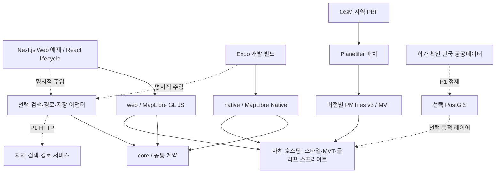

# Korea Map Kit 기술 아키텍처

원본 설계: 2026-10-19; 구현 정합성 갱신: 2026-10-20 KST. 상태: Web/공통 API·선택형 서비스 구현, 한국 4지역 타일·Chromium 실제 지도/경로 표본 통과, 전체 플랫폼 검증 미완료. [정책](../AGENTS.md), [요구사항](requirements.md), [로드맵](roadmap.md), [조사 근거](research/technical-review.md), [검증 기록](research/design-validation.md)을 함께 읽는다. 현재 비스코프 패키지명은 미등록으로 관찰한 미발행 후보이며 예약·소유권을 의미하지 않는다. 최신 작업 순서와 게이트는 [실행 계획](execution-plan.md)을 따른다.

## 1. 결정 요약과 MVP 경계

MapLibre GL JS(Web)와 MapLibre Native를 감싼 MapLibre React Native(Android/iOS)를 사용한다. TypeScript 코어는 좌표·카메라·피처·오류·서비스 계약을 공유하고, 렌더러 객체 및 플랫폼 UI는 공유하지 않는다. Next.js와 Expo는 예제 앱의 선택이며 SDK 사용자의 필수 프레임워크가 아니다. [ADR-001](decisions/001-renderers-and-platforms.md)

**MVP는 M1~M4의 합이다.** M1은 공통 계약과 모바일 호환성 확인, M2는 Web SDK, M3는 한국 지역 타일·한글 스타일·자체 호스팅, M4는 Android/iOS 실제 동작 검증이다. Web만 완성된 상태는 Web preview이며 전체 MVP가 아니다. 범위는 대한민국 내 명시한 시범 지역 한 곳부터 시작하고 전국 상세도·주소 완전성은 보장하지 않는다.

MVP에 포함: 지도, 한국어 라벨, 카메라, 마커·GeoJSON·선/면, 피처 선택, 스타일 교체, 출처 표시, 사용자 소유 스타일/타일, 유료 키 없는 자체 호스팅, 검색/경로 인터페이스 및 명확히 표시된 fixture 예제. 선택형 PostGIS POI 검색·Valhalla 경로 엔진은 P1으로 추가 구현했다. 실제 공공파일 적재·한국 타일·전체 플랫폼 통과는 검증 기록별로 판단한다. 공공데이터 대량 통합, 계정, Supabase, 오프라인 다운로드, 3D 지형, 실시간 교통, 내비게이션은 P1/P2다. **경로 선을 그리는 기능과 길찾기를 계산하는 서비스는 별개다.**

## 1.1 Zero Publisher Cost와 Provider 설정 계약

[ADR-009](decisions/009-zero-publisher-cost.md)와 [비용 감사](cost-audit.md)를 모든 패키지·데모·도구에 적용한다. SDK 설치/import/기본 테스트가 제작자의 API 키·DB·타일 서버·백엔드·유료 계정으로 요청하지 않게 설계한다. 무료 계정의 quota도 제작자 공유 자원이며 기본값으로 사용하지 않는다.

지도 입력은 명시적으로 선택한다. Web은 `local-fixture`, 운영자 `styleUrl`을 쓰는 `operator`, 검증된 JSON을 받는 `inline` 구성을 제공한다. 운영자 구성에는 필요한 origin 전체, 출처와 `costAcknowledged: true`를 전달한다. Native는 `local-fixture` 또는 `MapStyle`과 `NativeResourcePolicy`를 주입하는 `operator` 구성을 사용한다. 실제 설정 예제는 [Web 가이드](web-guide.md)와 [Native 가이드](native-sdk.md)가 기준이다.

`local-fixture`는 프로젝트 자체 소형 합성 데이터만 사용하며 서버에서 다운로드해 채우지 않는다. 빈 설정에 자동 fixture 모드를 적용하지 않고 renderer 생성 전에 실패한다. MapLibre RN 기본 demo style도 채택하지 않는다. 검색·경로·공공데이터 provider 미설정은 해당 기능의 명시적 오류이며 지도 자체는 유지한다. SDK가 제작자 계정·환경변수를 자동 탐색하지 않는다.

공공데이터 provider도 URL/데이터셋 ID/인증 필요 여부/비용 고지/허가 metadata를 운영자가 설정한다. 배치 명령은 명시적 input/config 없이는 다운로드나 클라우드 작업을 시작하지 않는다. key가 필요한 수집은 운영자 서버에서 수행한다. SDK가 제작자 환경변수·계정 profile·demo token을 탐색하지 않는다.

endpoint 소유자와 비용 책임은 provider 문서와 설정 화면에 표시한다. style의 source/TileJSON, glyph/fonts, sprite/icons/images 등 필요한 자산 origin을 명시한다. Web renderer 요청 검증과 Native 리소스 입력 검사는 플랫폼별 책임이다. 이 origin 검사를 HTTP redirect 방화벽이나 임의 사용자 layer 코드의 네트워크 sandbox로 표현하지 않는다. 신뢰할 수 있는 운영자 자산과 직접 응답·CSP·서비스 quota를 사용하고 실제 목적지를 별도로 감사한다. Native의 remote style/TileJSON/GeoJSON·자격증명 URL 제한은 [지원 정책](native-sdk.md)을 따른다.

Secret은 운영자 서버에만 둔다. browser/native 환경변수, `NEXT_PUBLIC_*`, `EXPO_PUBLIC_*`, config plugin 출력·native resource·소스맵·bundle은 공개 정보다. client-safe identifier도 비용·quota를 사용할 수 있어 제작자의 값을 번들하지 않는다. 사용자 endpoint/키를 로그·telemetry·오류 리포트·설정 예시에 기록하지 않는다. Git에는 개인 서버 주소나 결제 account/project ID를 넣지 않고 placeholder 또는 값 없는 template만 둔다.

기본 예제/공개 데모는 same-origin 소형 fixture로 구성한다. 검색·경로는 표시된 로컬 fixture만 제공하며 외부 provider 전환은 운영자가 자기 환경에 설치한 뒤 설정한다. 공개 데모에 공유 API 키·범용 proxy·token 발급 서버·사용자 입력에 따른 원격 질의·실시간 전국 갱신을 두지 않는다. CSP 및 서비스 구성으로 외부 connect를 기본 차단하고 fonts/workers/icons도 로컬로 제공한다. 정적 호스팅 역시 비용이 있을 수 있어 무료 한도와 유료 전환 차단을 확인한 배치만 별도 승인 후 허용한다. 한도 초과 시 유료 fallback 대신 중지한다.

기본 build/test는 로컬 장비와 합성/허가 fixture로 실행한다. 공개 registry의 의존성 다운로드와 지도 서비스 API 호출을 구분하되 install/prepare hooks 및 전이 의존의 telemetry·다운로드도 검사한다. EAS/유료 원격 빌드·DB·제작자 remote cache는 필수가 아니다. 실제 대형 OSM 배치/검색 품질 테스트는 운영자 opt-in 작업이며 기본 unit/E2E에 넣지 않는다.

Actions는 무료 조건을 충족하는 공개 저장소 표준 runner를 기본으로 한다. larger/GPU/custom image·유료 self-hosted 인프라·스토리지 초과·paid cache·deploy는 별도 승인 없이 켜지 않는다. 최초 CI는 가벼운 검사, 최소 권한, timeout·concurrency 취소 정책으로 시작한다. artifact/cache는 무료 한도·retention을 확인한 뒤 도입하며 한도를 늘리는 계정 설정을 자동 변경하지 않는다. 현재 일반 CI와 기본 비활성 수동 발행 workflow가 존재한다. 의존성 감사와 발행 전 전체 Web QA 보강은 실행 계획 B에서 검증한다.

배포 gate는 Git/실제 npm tarball/Web bundle/모바일 앱의 비밀정보·endpoint 정적 검사와 **설치·import·실행·테스트의 실제 네트워크 목적지/요청 수 검사**다. `docs/cost-audit.md`에 커밋/artifact hash, 조건, 요청 소유자·비용, 차단 결과와 미검증을 기록한다. 정적 검사·현재 Web fixture 외부 요청0을 Native OS 전체 네트워크나 모든 운영자 구성의 비용 합격으로 확대하지 않는다. 구체적인 검사 순서는 해당 감사 문서를 따른다.

## 2. 구성과 의존 방향



`core`는 React, MapLibre, DB, Supabase, 네트워크 SDK를 import하지 않는다. `web → core + styles`, `native → core + styles`, `styles → core`, `data-adapters → core` 방향만 허용한다. 런타임 순환 의존을 금지하고 타입 import도 같은 경계를 유지한다. 서버 바이너리·데이터·DB 드라이버는 npm 클라이언트 패키지에 포함하지 않는다.

```text
KoreaMap/
  AGENTS.md / README.md / LICENSE
  packages/
    core/                    # ES-only 공통 계약/검증; 외부 의존성 없음
    web/                     # GL JS; React lifecycle은 현재 예제에서 처리
    native/                  # MapLibre RN; Expo 개발 빌드 대상
    styles/                  # 4종 토큰·design-v1 스타일·합성 fixture
    data-adapters/           # 합성/명시적 운영자 transport·검색·경로
  examples/
    web/                     # private Next.js 소비 앱
    expo/                    # private Expo 소비 앱
  services/
    geo-data/                # private CSV ETL·PostGIS·read-only 조회
    search/                  # private PostGIS POI·공간/문자열 검색
    routing/                 # private 선택형 Valhalla gateway; 검색/DB와 독립
    tiles/                   # private Planetiler/profile·archive·XYZ 구현 중
  tests/unit/
  tests/e2e-web/
  scripts/
  docs/decisions/
  docs/research/
  .github/workflows/
  .changeset/
```

사용자의 모노레포 구축 지시에 따라 위 경로로 실제 생성했다. geo-data/search/routing은 실행 가능한 선택형 private 운영자 서비스이며 SDK npm에 포함하지 않는다. tiles는 같은 격리 경계에서 구현한다. 기본 빌드/fixture 지도에 서비스·다운로드·Java/Docker를 요구하지 않는다. 별도 React 패키지나 전국 고배율 도구를 필요 없이 추가하지 않는다. 현재 코드 범위와 미구현 API는 [개발 가이드](development.md)에 구분한다.

초기 생성은 필요한 디렉터리에 한정한다. P1/P2 폴더를 빈 패키지로 미리 발행하지 않는다. pnpm workspace + TypeScript 프로젝트 참조로 시작하고 작업 캐시 도구는 빌드 시간 측정 후 도입한다. [ADR-008](decisions/008-release-and-quality.md)

## 3. 렌더러·플랫폼 경계

Web: MapLibre GL JS 인스턴스 생성·파괴는 DOM이 생긴 후 수행한다. Next.js에서는 client component 안에서 dynamic import하며 서버에서 WebGL/DOM에 접근하지 않는다. CSS·worker/CSP 경로를 문서화하고 React Strict Mode의 중복 mount 및 cleanup을 검증한다. React 소비자가 아니어도 `web`만 사용할 수 있다.

모바일: Expo Go는 지원하지 않는다. config plugin, prebuild 또는 동등한 native 프로젝트 설정, development build가 필요하다. 로컬 Android 빌드와 macOS/Xcode iOS 빌드를 지원하고 EAS 유료 서비스를 필수로 두지 않는다. MapLibre RN v11의 New Architecture 요구와 Expo SDK의 RN/React 조합을 함께 고정한다. Native 의존 버전은 RN 래퍼가 선택한 버전을 우선하며 독자 override는 ADR 수정과 두 플랫폼 빌드 검증 후에만 한다.

| 기능 | Web | Android/iOS | 공통 정책 |
| --- | --- | --- | --- |
| 지도·카메라·GeoJSON 선택 | GL JS | Native 래퍼 | 공통 입력/이벤트 계약 |
| 마커 상세 UI | HTML/React | native view/앱 패널 | 데이터와 선택 상태 공유, DOM 요소 전달 금지 |
| 커스텀 스타일 | style JSON | 지원하는 동일 명세 부분집합 | 지원하지 않는 expression을 검증 오류로 반환 |
| 키보드 | 키보드 조작·포커스 | 접근성 액션 | 앱의 리스트/버튼으로 동등한 탐색 제공 |
| 터치·포인터 | 마우스/터치 | 터치 | 플랫폼 관습 유지, 원시 제스처 동일성 보장 안 함 |
| PMTiles 직접 접근 | `pmtiles` protocol | Native 지원 있음 | 통합 검증 후 capability 활성화; MVP 기준은 XYZ |
| 오프라인 패키지 | 별도 캐시 설계 | Native API 제약 존재 | P2, PMTiles 지원을 offline pack 지원으로 간주 금지 |

MVP는 Web Mercator 평면 지도를 공통으로 사용한다. globe, terrain, custom shader, MapLibre의 새로운 MLT 형식은 P2다. 공개 style schema `version: 8`과 프로젝트 tileset schema 버전은 서로 다른 버전 축이다.

## 4. 공통 데이터 모델 및 API

구현된 공개 계약은 [Public API](public-api.md), [core 선언 기반 문서](api/core.md), [실제 contracts](../packages/core/src/contracts.ts)를 기준으로 한다. 최초 설계의 가상 `moveCamera/setOverlays/ServiceResult` 예제를 설치 가능한 API로 사용하지 않는다.

- `Coordinate`는 WGS84 `[longitude, latitude]`, `MapBounds`는 west/south/east/north 객체다. 날짜변경선 횡단은 west > east로 표현하며 공통 검증과 플랫폼별 처리를 검사한다. Mercator 렌더링 위도 제한과 원본 CRS 검증을 분리한다.
- `MapCamera`, `MapMarker`, `MapStyle`, `MapLayer`, `MapRoute`, `Place` 및 GeoJSON Point/LineString/Polygon 부분집합을 사용한다. nested properties·Multi*·고도까지 지원한다고 확대하지 않는다. 피처/장소의 안정 ID와 출처·라이선스를 보존한다.
- `MapController`는 `setCenter`, `setZoom`, `setCamera`, `fitBounds`, `setStyle`, 마커/GeoJSON 추가·제거, `showRoute`, `getVisibleBounds`, `onEvent`, `destroy`를 제공한다. Web의 `handle.api`와 Native ref가 같은 타입을 사용한다. 공개 비동기 명령은 ready 이후 호출한다.
- `MapEvent`는 ready/idle/destroyed, camera/click/select/error다. DOM/native 엔진 이벤트 객체나 UI 컴포넌트를 core로 전달하지 않는다. 엔진별 timing·gesture·이미지 등록 차이는 어댑터가 처리한다.
- core 취소는 DOM 없는 `CancellationSignal`과 주입형 `Scheduler`다. timeout/취소/오류 code는 공통 검증을 사용한다. engine 명령 완료와 실제 frame 표시 완료를 동일시하지 않으며 style은 별도 ready 경계를 가진다.
- `SearchProvider`, `GeocodingProvider`, `RoutingProvider`, `LocationProvider`, `PlaceRepository`, `TileProvider`는 명시적 주입 계약이다. POI 조회·한국 검색·foreground 위치/경로 기록 확장은 공통 core 순수 함수와 선택형 transport를 사용한다.
- 지도에 경로 좌표를 표시하는 `showRoute`와 도로 경로를 계산하는 `RoutingProvider`를 분리한다. 서비스 실패를 직선·다른 모드로 숨기지 않는다.
- EPSG:5174/5179/5186 등 원본은 데이터별 CRS 확인 후 ETL에서 변환한다. `ST_SetSRID`는 변환이 아니며 `ST_Transform` 또는 검증된 PROJ 연산을 사용한다. 위치가 없는 POI는 null로 유지하고 추정 좌표를 넣지 않는다.
- 거리 m, 시간 s, 애니메이션 ms, bearing/pitch degree, Web CSS px/Native 논리 padding을 사용한다. SDK가 입력 객체를 변경하지 않는지 순수 함수/컨트롤러 검사로 검증한다.

공통 계약의 타입/단위 검증은 플랫폼 실화면 동등성 증거와 구분한다. 실제 앱 저장·암호화·동기화·삭제 정책은 소비 앱 책임이며 core가 특정 DB/auth를 선택하지 않는다.

## 5. 타일 생성·배포·자체 호스팅

[ADR-003](decisions/003-tiles-and-hosting.md). 2026-10-20 구현은 private `services/tiles`의 프로젝트 자체 Planetiler profile과 **MBTiles에 담은 MVT + 공통 HTTP XYZ** 경로를 우선한다. 최초 설계의 PMTiles/Martin 조합은 선택형 대안으로 유지한다. archive 형식과 클라이언트 PMTiles 직접 접근은 별개다. core/npm 기본 설치에는 Planetiler/JDK/DB/다운로드를 넣지 않는다.

첫 지역은 서울 소형 bbox, 최대 z14다. 서울/울산/부산/제주 실제 config의 bbox·입력 buffer·zoom을 manifest에 기록한다. 원본 설계의 서울 주변 제안 `[126.76,37.42,127.19,37.72]`는 행정경계나 완료 coverage를 뜻하지 않으며 실제 자원 한도와 경계 검사에 따라 줄일 수 있다. 전국 명령 제공과 실제 전국 생성 성공을 구분한다.

profile과 스타일은 `design-v1` 정규화 계약을 공유한다. source-layer는 `land`, `park`, `water`, `building`, `boundary`, `road`, `trail`, `place`, `poi`이며 피처에도 같은 `kind`를 유지한다. road의 `class`는 major/minor, poi의 `poi`는 park/parking/trail/facility다. 이름은 NFC 정규화한 `name:ko`, `name`, `name:en`만 보존하고 style은 이 순서로 fallback한다. 불필요한 contact/개인 태그를 공개 타일로 옮기지 않는다. 초기 profile은 OSM polygon 기반 녹지/내륙 수역과 도로·건물·지명 등을 다룬다. 별도 coastline/ocean polygon·지형·철도 스타일·전국 주소 완전성을 포함한다고 주장하지 않는다.

처리 순서는 A 원장·권리·기한 확인 → 명시적 입력 PBF hash/기준일 확인 → 고정 tool/profile 생성 → layer/경계/크기/한글·HTTP 확인 → immutable 세대 manifest → 검증 후 명시적 선택이다. manifest에는 input/output SHA-256, profile hash, 도구 버전, bbox/zoom, schema, font/glyph hash·권리·데이터 기준일을 기록한다. 실패하면 기존 성공본을 유지하며 선택/rollback은 자산 전체 세대로 다룬다. 증분/자동 정기 갱신은 초기 범위에 없다.

| 배치 형태 | 사용처 | 구성 |
| --- | --- | --- |
| 공통 기본형 | Web/Android/iOS 검증 우선 | 정적 style/glyph 자산 + MBTiles/MVT의 경량 HTTP XYZ 서버, DB 불필요 |
| PMTiles archive형 | 후속 운영 선택 | 고정 archive와 검증된 Martin 등 XYZ 변환 서버 |
| Web 직접형 | P1 선택 최적화 | Range 지원 서버 + 명시적 PMTiles JS protocol; 현재 직접 접근 검증 별도 |
| Native 직접형 | P1 선택 실험 | RN/OS 실제 조합의 Range·캐시 검증 후 opt-in, 일반 XYZ 대체 유지 |
| 동적형 | 후속 선택 | PostGIS 등 변경이 잦은 레이어에만 사용; 기본 지도 필수 아님 |

HTTP 서버는 정확한 z/x/y 범위·MIME·gzip·CORS·오류/빈 타일을 검사한다. 200 빈 문자열을 MVT로 보내지 않는다. Native는 검증된 inline style와 직접 tiles 배열을 받으며 remote TileJSON/스타일 지원을 추정하지 않는다. 운영 서버는 HTTPS, 로컬 loopback 시험은 명시적 HTTP 예외다. 휴대폰 localhost는 개발 PC가 아니다.

PMTiles 직접 실험은 Range GET 206, Content-Range/Length, CORS/노출 헤더와 재시작·cache 오류를 양 플랫폼에서 검사한다. 파일 전체 HTTP 재압축으로 offset을 변경하지 않는다. 이것이 통과하기 전 공통 경로는 XYZ다.

입력·폰트·glyph·tile archive와 실제 지도 QA 캡처는 ignored 운영자 저장소에 둔다. 공개 Git/npm에는 생성 코드·구성·문서만 넣는다. 보존은 최소 현재+직전 성공본이며 디스크 부족 때 기존 성공본을 자동 삭제하지 않는다. 무료 SDK와 운영자의 저장·트래픽·배치 장비 비용을 구분한다. 실제 생성/브라우저/기기 결과는 [실행 계획](execution-plan.md)의 게이트와 [타일 실행 가이드](tiles.md)를 따른다. 서울·울산·부산·제주 z0~14 archive와 BMP glyph pack, 실제 Chromium 9화면 및 서울 두 세대 activate/rollback을 수행했다. 같은 OSM 원본의 실제 Valhalla 4경로도 서울 지도 1440/390px에서 출처·오류·정리를 포함해 통과했다. 전국 명령은 디스크 게이트로 실패했고 다른 브라우저·기기·전국 품질/성능은 미검증으로 남긴다.

## 6. 스타일·한글·글리프

[ADR-004](decisions/004-style-and-glyphs.md). 스타일 JSON을 사용자 입력으로 받고 Standard/Dark/Pastel/Outdoor 4종의 색/라벨/zoom 토큰을 제공한다. 완전한 GUI 스타일 편집기는 P2다. MapLibre 명세 전체를 자체 재구현하지 않고 upstream validator에 플랫폼별 지원 검사와 tileset schema 검사만 추가한다. 고객의 별도 tileset/style 쌍은 허용하되 기본 스타일과 임의 schema의 자동 호환은 약속하지 않는다.

한국어 표기는 구현된 design-v1의 `name:ko → name → name:en → 빈 값` 순서다. 한글 완성형, 자모, 영문, 숫자, 문장부호와 실제 데이터에 필요한 한자를 점검한다. Noto Sans CJK KR 등 OFL 폰트의 정확한 파일·버전·라이선스를 확인한 뒤 SDF PBF를 생성한다. 글리프는 `{fontstack}/{range}.pbf`의 256 code point 범위로 정적 호스팅한다. Web의 local font 기능을 Native에서도 된다고 가정하지 않는다. fontstack 이름·URL 인코딩·복합 fallback과 missing glyph를 검증한다.

자체 작성 아이콘을 sprite로 제공하고 1x/2x atlas와 JSON을 함께 versioning한다. 폰트/glyph와 데이터 타일은 npm core에 포함하지 않는다. OFL 고지·변형명 제한과 데이터 출처는 assets release에 보존한다. 폰트 제작 파이프라인 자체의 라이선스도 도입 전에 검토한다. 초기 생성 도구의 exact version/digest는 M3에서 확정한다.

## 7. 검색·지오코딩·경로 추상화

[ADR-005](decisions/005-optional-services.md). 핵심 지도는 주입 가능한 provider 계약과 합성 fixture로 독립 동작하며 선택형 자체 검색·라우팅 구현을 분리한다. fixture는 “데모 데이터 / 실제 검색·길찾기 아님”을 표시한다. provider를 주지 않으면 검색/경로 UI는 비활성 또는 숨김이며 지도는 정상 작동한다. 임의 공용 서버로 자동 fallback하지 않는다.

| 엔진 | 적합성 | 결정/비용 |
| --- | --- | --- |
| PostGIS POI | 적재한 POI 이름/주소·공간·카테고리·자동완성 | 현재 첫 선택형 검색 구현; 실제 원본/한국어 평가셋과 규모 품질은 별도 검사 |
| Nominatim | OSM 명칭/주소 검색·역지오코딩 | 별도 GeocodingProvider 대안; 기본/자동완성 공용 서버로 연결하지 않음 |
| Photon | 다국어·오타·자동완성, OpenSearch 기반 | P1 실사용 수요 및 한국어 검색 품질 확보 후; JVM/인덱스 운영 추가 |
| Pelias | 여러 출처를 함께 넣는 검색 파이프라인 | P2; importers/검색 저장소 등 여러 서비스 유지비가 큼 |
| OSRM | 사전 처리 road graph의 경로 질의 | 대안으로 보류; 모드별 그래프 운영 부담 |
| Valhalla | 다양한 이동 모드·비용 모델 | 사용자 요청 3모드에 따라 P1 채택: 3.9.1, 선택형 자체 Docker/주입 어댑터. [운영/검증](routing.md) |
| GraphHopper | Java 엔진·custom model | 대안; OSS 엔진과 유료 hosted API의 기능/조건을 분리 |

provider의 서버 URL, timeout, 제한된 credentials 전달 방식을 소비자가 지정한다. 서비스 timeout 기본값은 검색 5초/경로 10초로 제안하며 호출자가 조정 가능하다. 검색은 composition 종료 후 NFC 정규화, 300ms debounce, 이전 요청 취소 및 응답 requestId 대조를 앱 레이어에서 적용한다. 자동완성은 해당 capability와 운영 정책이 허용할 때만 활성화한다. 공용 Nominatim을 SDK 자동완성/기본 검색 서비스로 연결하지 않는다.

Valhalla의 좌표·mode·GeoJSON 응답·거리 m/시간 s·snap 위치를 어댑터에서 정규화한다. `walking`을 `driving`으로 대체하지 않는다. 연결되지 않은 길·섬·일방통행·진입 제한·데이터 갱신 시점·행정경계에서 결과를 시험한다. 표시 타일과 경로 graph는 별도 산출물이며 생성 시각을 각각 표시한다. 경로는 참고 정보이며 실제 교통·법규·내비게이션 보증을 MVP에 포함하지 않는다.

서비스 오류는 계약 코드로 정규화한다. 429는 retry-after를 보존하고 무한 재시도하지 않는다. 5xx 재시도는 취소 가능하고 멱등 요청에 최대 1회 jitter를 적용한다. query·좌표·토큰 원문을 로그에 넣지 않는다. 네트워크 수신 데이터를 제한된 크기와 schema로 검사하고 팝업을 임의 HTML로 렌더링하지 않는다. 서버 proxy가 있다면 허용 upstream 목록을 고정해 SSRF를 막는다.

## 8. PostGIS·한국 공공데이터·선택 저장소

[ADR-006](decisions/006-data-licenses-and-postgis.md). PostGIS는 핵심 SDK나 최초 타일 빌드의 필수 요소가 아니다. P1 공공 레이어의 재현 가능한 정제·중복 관리·반경 질의가 필요할 때 도입한다. `raw → normalized → publish` 단계와 provider별 테이블/스키마를 구분하고 OSM과의 결합 여부를 기록한다.

정규화 스키마는 `source_id`, `source_record_id`, `dataset_version`, `license_id`, `fetched_at`, `valid_from`, `raw_crs`, `geometry(4326)`를 포함한다. 원본은 immutable object storage에 별도 보관한다. GiST 공간 인덱스를 사용하고 meters 반경은 geography 또는 적절한 투영좌표에서 계산한다. `ST_DWithin`, bbox prefilter, limit, prepared query와 query plan을 검증한다. 운영 DB의 모든 테이블을 Martin auto-discovery로 노출하지 않고 공개 view/function allowlist를 사용한다. 동적 MVT는 bbox·zoom·행 수·시간 제한을 둔다.

한국 데이터 후보: 전국공공시설개방정보(도로명/지번주소·좌표 포함), 한국관광공사 관광정보, 주소정보누리집의 주소 데이터. 현재 [데이터 원장](../data/sources.json)은 A6/B0/C8/D2로 권리 범위를 구분한다. A는 저장/배포 권리 후보이며 실제 수집 성공 수가 아니다. 기존 CSV ETL profile 3종의 실파일 취득/헤더/기준점은 별도 검증 중이다. API 무료 여부, 인증키 필요, 대량 다운로드, 이미지 권리, 보관/재배포 조건을 각각 확인해야 한다. MVP를 미확인 공공데이터에 종속시키지 않는다.

Supabase는 선택 저장 어댑터의 한 구현이다. 북마크·사용자 레이어를 저장하되 auth 모델과 DB 테이블을 core Place 모델에 섞지 않는다. 클라이언트 publishable key와 서버 secret/service-role 키를 구분하고 공개 스키마에는 소유권 RLS 및 적절한 GRANT를 설정한다. 다른 Postgres/HTTP 저장소로 교체 가능해야 한다. 현 단계에서는 Supabase 프로젝트·테이블·계정을 생성하지 않는다.

## 9. 라이선스와 출처 표시

SDK의 자체 작성 코드는 MIT 목표, MapLibre GL JS/Native 등의 BSD·래퍼 MIT·도구 Apache·폰트 OFL·OSM ODbL은 각각 보존한다. Nominatim/PostGIS의 GPL 계열 서버를 npm SDK에 복사/번들하지 않으며 별도 서비스로 제공해도 바이너리/이미지 재배포의 해당 의무는 검토한다. 네트워크 분리만으로 모든 라이선스 의무가 없어지는 것은 아니다.

데이터 manifest의 필수 항목: 원본 URL, 기관/권리자, 취득일과 데이터 기준일, file hash, license ID/URL, 가공·상업이용·재배포 허가 근거, 출처 문구, OSM 결합 여부, 검토자/검토일. 권리가 불명확하면 publish를 차단한다. 공공누리 0/1유형 및 별도 자유 이용허락을 우선 검토하고, 2/3/4유형의 비상업·변경금지 조건은 범용 SDK 기본 데이터에 부합하지 않으므로 제외한다. 유형만으로 개인정보·제3자 권리까지 허가된다고 보지 않는다.

OSM은 © OpenStreetMap contributors와 ODbL 링크를 지도에서 접근 가능하게 표시한다. 데이터와 검색 결과의 attributions를 병합하고 작은 화면·패널·스크린샷에서도 가려지지 않게 한다. produced work, derivative database, collective database 구분은 실제 데이터 결합 방식으로 판단하며 타일 파일 분리만으로 ODbL 의무가 없어졌다고 선언하지 않는다. 데이터 배포물에는 필요한 원본/파생 DB 제공 방식과 고지를 함께 기록한다.

SDK의 자동 출처 수집은 누락 방지 도구다. 사용자가 제공하는 style/source가 올바른 출처 정보를 갖는지 계약상 요구하고, 출처가 필요한데 비어 있으면 검증 오류를 표시한다. 외부 attribution의 임의 HTML은 실행하지 않고 text/허용 URL로 렌더링한다.

## 10. 성능·비용·운영 목표

아래 수치는 **측정 전 합격 목표**이며 현재 성능 결과가 아니다. M1에서 고정 시험 장비/OS/browser 버전과 시범 bbox·fixture hash를 남긴다. M2/M4에서 충족 여부를 측정하며 실패 시 기능 범위를 줄이거나 ADR로 목표 변경 근거를 남긴다.

| 항목 | MVP 제안 목표 | 측정 방법 |
| --- | --- | --- |
| 최초 유효 지도 | cold p95 ≤ 3초, warm p95 ≤ 1.5초 | 20Mbps/RTT 80ms 통제 네트워크, 30회; 단순 load가 아닌 타일·한글 라벨 렌더 확인 |
| 지도 조작 | 30초 pan/zoom의 frame time p95 ≤ 33ms | 고정 1,000점 fixture를 GPU circle/symbol layer로 표시, 실기기/실브라우저 trace |
| 반복 lifecycle | 최초 목표: 20회 mount/unmount 후 잔여 map/worker/listener 없음 — 공유 worker 제약으로 전체 목표 미충족 | 지도별 자원 해제·worker 수 비증가를 따로 관측; 목표 조정은 근거와 재검토 필요 |
| 자체 코드 bundle | core ≤ 30KiB gzip, web+react 자체 코드 ≤ 60KiB | MapLibre/React 의존 제외 수치와 전체 전송량 둘 다 보고 |
| 타일 예산 | 시범 bbox z0~14, compressed MVT p95 ≤ 300KiB | 생성 후 크기 분포·과대 타일 목록; 초과 시 레이어/일반화 조정 |

MapLibre GL JS 6.14.0은 마지막 지도 종료 후 공유 dispatcher worker 1개를 유지하는 것으로 관찰했다. per-map listener/observer/DOM 정리와 반복 mount에서 worker 비증가 검증은 기존 잔여 worker 0 목표의 합격을 뜻하지 않는다. 원인을 해결하거나 근거 있는 목표 재검토를 하기 전 전체 lifecycle 성능 게이트를 통과로 표시하지 않는다.

대량 POI는 DOM/native marker 수천 개 대신 GPU layer 및 필요 시 clustering을 쓴다. source 전체 setData 반복 대신 가능한 범위 업데이트를 측정한다. 전체 앱 절대 RAM 상한은 장비·Native 버전을 먼저 고정한 뒤 M1에서 설정하고 측정 없이 통과를 주장하지 않는다.

비용 추정식: `월 비용 = 저장 GB × 단가 + origin 요청 × 단가 + egress GB × 단가 + 서버 시간 × 단가 + 배치 실행 시간 × 단가 + 백업`. 예시 가정 10,000 세션 × 3MB/세션은 약 30GB 전송이며 실제 관측값이 아니다. CDN hit율과 origin 요청 감소는 최종 사용자 egress와 구분한다. 공급자 무료 구간을 보장하지 않는다. 지역·최대 zoom·갱신주기·retention을 운영 설정으로 제한하고 예산 80%/100% 알림, 자동 대량 재빌드 금지, 명시적 스케줄 opt-in을 적용한다.

초기 지도 데이터는 수동 release, 이후 주간/월간 갱신을 데이터 출처 주기에 맞춘다. batch 실패는 이전 release 유지, 검색/경로 장애는 지도 유지와 서비스별 오류로 격리한다. 기본 telemetry는 꺼져 있으며 수집한다면 opt-in, 요청 수·지연·오류율·타일 cache hit만 집계한다. 위치/검색 원문·식별자 보관은 별도 동의·보존 정책 없이는 하지 않는다.

## 11. 버전·배포·검증 정책

정확한 **첫 호환성 시험 후보 버전**은 [조사표](research/technical-review.md)에 기록했다. 원본 설계 단계에는 설치하지 않았다. 후속 모노레포 단계의 실제 설치·lockfile·JS 빌드·잔여 보안 문제는 [도구 검증](research/monorepo-toolchain.md)과 [비용 감사](cost-audit.md)에 기록한다. Android x86_64 APK와 제한적 합성 emulator 실행 기록은 존재한다. 현재 후보의 독립 Native 소비는 설치·plugin·JS export 통과와 상위 RN 선언 실패가 함께 있는 `PARTIAL_PASS`이며 Android 실기기·iOS 빌드/화면은 미검증이다. [독립 소비 기록](research/native-consumer-validation.md)을 따른다. 실제 설치 조합은 packageManager/engines/exact dependency/lockfile과 Native engine/plugin 버전으로 고정하며 새 조합은 다시 검증한다. npm peer 범위는 실제 검증한 조합만 문서화하고 사용자의 renderer 중복 설치를 피한다.

공개 API SemVer와 데이터 스키마/스타일/데이터 날짜 버전을 분리한다. 초기 패키지는 `0.x`, breaking change는 minor를 올리고 migration note를 제공한다. core/web/native/styles/data-adapters 5개는 현재 같은 0.1.0 미발행 baseline과 Changesets fixed group을 유지한다. 초기 pending 항목은 CHANGELOG에 통합했으며 이후 변경은 실제 버전 PR에서 검토한다. 다른 독립 어댑터를 추가할 경우 호환 core 범위를 명시한다. 대형 지도 데이터는 npm/Git에 넣지 않는다. GitHub 공개 상태와 출시 readiness는 별개다.

CI는 lint/types/build/contract, 패키지 exports, `npm pack --dry-run`, 소비 앱 설치, Web E2E, Android 및 macOS iOS 빌드·실화면 QA, attribution/license/SBOM, dependency audit, credential scan을 단계에 맞게 실행한다. native/브라우저 테스트가 실행되지 않으면 해당 플랫폼은 미검증이며 MVP 완료·발행을 막는다. 공식 예제 관찰은 프로젝트 E2E가 아니다.

릴리스는 검증된 커밋과 artifact hash를 대상으로 별도 승인한다. 보호된 release 환경·단기 OIDC/npm provenance를 우선하며 로그·PR에 토큰을 넣지 않는다. 기존 stacked PR은 각각의 실제 부모를 base로 사용했다. ancestry와 최종 tree를 로컬 통합 브랜치에서 예행하고 승인된 통합 계획에 따라 main을 정렬한다. 현재 Public 저장소의 새 push/PR은 공개 업로드이므로 사용자 승인 조건을 적용한다. **main 병합, 운영 배포, 공개 저장소 전환, npm 실제 발행은 각각 사용자 명시적 승인 후에만 수행한다.** 이전 첫 작업 병합 승인은 이번 설계 PR에 적용하지 않는다.

## 12. 재검토 조건과 위험

- Expo/RN/Native 호환성 실패: M1에서 원인과 공식 지원 조합을 재조사하고 버전표 수정. 모바일을 뒤로 숨긴 채 전체 MVP 완료 금지.
- 한국 라벨/주소 품질 부족: 데이터 기준일과 누락 사례를 공개하고 P1 데이터 보강을 별도 진행. 상용 지도 데이터를 보충재로 복사하지 않는다.
- PMTiles Range/Native cache 차이: 기본 XYZ 경로 유지, 직접 접근은 opt-in. 오프라인은 별도 manifest/checksum/용량/권리 설계 후 P2.
- 한글 glyph 크기·폰트 라이선스: 필요한 문자 범위와 fallback을 검증하되 음절 누락을 성능 최적화로 정당화하지 않는다.
- 신규 schema/과도한 배치 시간: 지역 bbox와 레이어 범위를 축소해 검증; 기존 global schema를 채택할 경우 해당 스타일/데이터 고지를 포함하는 새 ADR 필요.
- 서버 운영 부담: 검색/경로/PostGIS를 개별 배치하고 사용하지 않는 서비스는 설치·기동하지 않는다. 초기 Kubernetes·multi-region·상시 전국 graph rebuild는 제외한다.

## 공통 Public API 구현 연결

[Public API](public-api.md)와 [생성 선언 문서](api/core.md)가 0.x 구현 계약이다. core의 `MapController` → `MapPort` 경계를 두고 Web의 `MapHandle.api`, React Native의 `MapView` ref를 연결했다. 공유 데이터·검증·취소/기한 처리는 ES2022-only core에 있고, 타이머/엔진 수명·화면·resource policy는 어댑터에 있다. `SearchProvider` 등 여섯 provider 인터페이스는 opt-in 계약이며 기본 서비스가 아니다. Native는 운영자 inline style/direct XYZ·glyph·sprite와 입력 origin gate를 제공하며 remote style/TileJSON·임의 redirect 통제는 지원 범위와 실제 네트워크 결과를 별도 확인한다. 설계상 목표와 플랫폼별 실제 검증 범위는 기능 동등성 표를 따른다.
