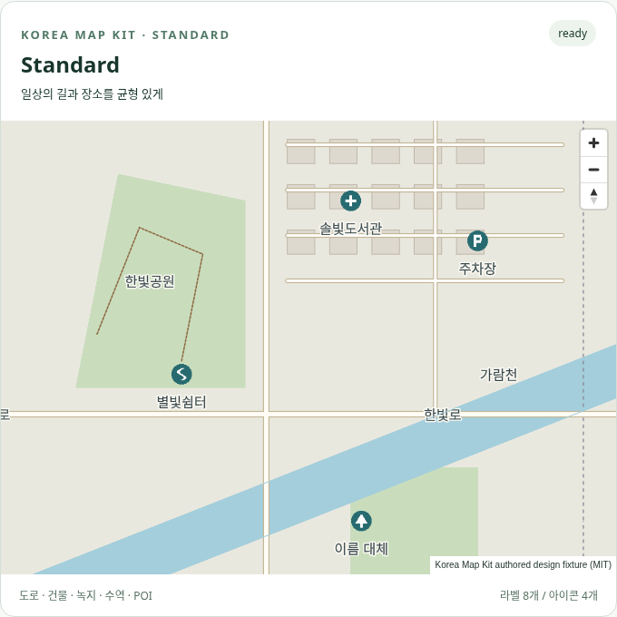
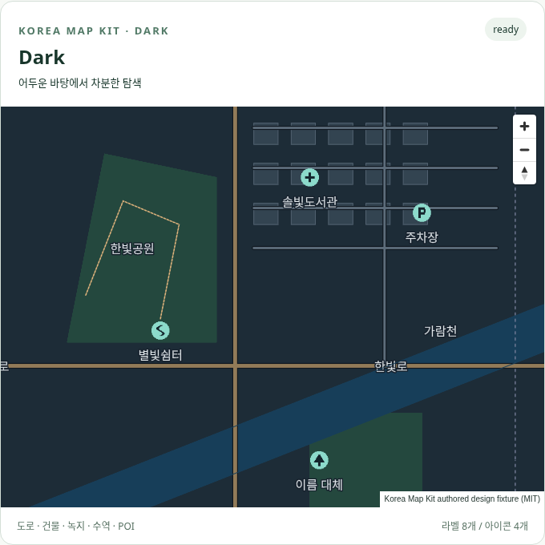
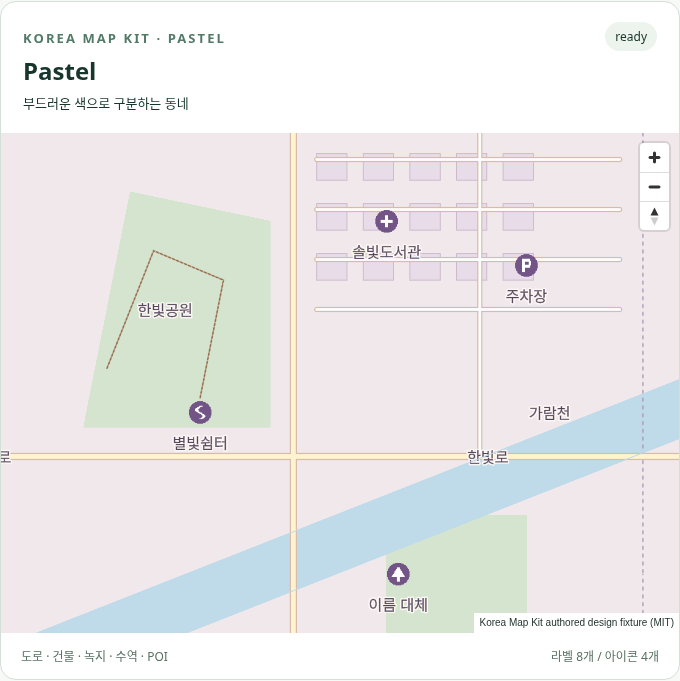
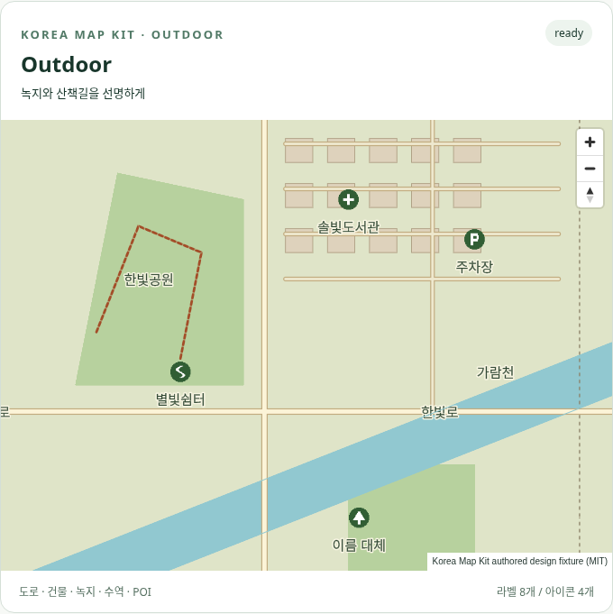

# Korea Map Kit 지도 디자인 시스템

확인일: 2026-10-19. `packages/styles`가 데이터·백엔드·React와 분리된 토큰/스타일/아이콘/한국어 검증 API를 제공한다. 지도 엔진은 MapLibre GL JS 6.14.0, 문법 검사는 `@maplibre/maplibre-gl-style-spec` 26.4.4를 유지했다. 의존성 버전 변경은 없고 Web 예제에 styles workspace 연결만 추가했다.

## 독립 디자인 방향

Standard는 종이색 바탕과 명확한 도로 위계, Dark는 짙은 청회색 바탕과 밝은 지명, Pastel은 낮은 채도의 보라·분홍·청록 계열, Outdoor는 녹지와 굵은 적갈색 산책길에 초점을 둔다. 특정 상용 지도 팔레트·스타일 JSON·아이콘·타일을 복사하지 않았다. 합성 동네의 도형·이름·시설은 직접 작성했으며 좌표가 한국 범위에 있어도 실제 서울 지형이나 시설을 나타내지 않는다.

REA/Ghidra MCP는 현재 callable 도구에 없고, ADB·Ghidra·xcrun도 설치되지 않았다. 권한 있는 외부 앱 세션이나 바이너리는 제공되지 않았다. 우회·추출 없이 공식 [NavigationControl](https://maplibre.org/maplibre-gl-js/docs/API/classes/NavigationControl/), [AttributionControl](https://maplibre.org/maplibre-gl-js/docs/API/classes/AttributionControl/) 문서와 같은 날 기록된 [공개 예제 관찰](research/ux-observations.json)을 참고했다. 기존 공개 예제의 popup 화면도 다시 열어 위치 연결·닫기 패턴을 확인했다. 상용 서비스 실측 또는 이번 REA 실행으로 보고하지 않는다.

참고한 패턴은 가까운 줌/회전 조작, 지점과 연결된 팝업, 항상 찾을 수 있는 출처, 움직임에 따른 위치 유지다. 팔레트·기호·레이어 위계는 이 저장소에서 따로 설계했다. 검색/경로 서비스 UI의 전체 재설계는 이번 범위가 아니다.

## 공통 토큰과 표시 규칙

| 항목 | 공통 규칙 / 차이 |
| --- | --- |
| 도로 | major/minor 색·casing 분리. major 폭 z10/14/18 = 1.4/4.8/14 px, minor = 0.6/2.8/9 px, casing 양쪽 +1.2 px |
| 건물 | 채움/테두리 별도, 테두리 0.8 px, z14 이상 |
| 공원/녹지 | land와 park 분리; Outdoor는 녹지와 산책길 강조 |
| 수역 | fill 토큰; 사용자 색상 오버라이드 예제 제공 |
| 행정 경계 | 1.3 px, [3,3] 대시, z8 이상; 법적 행정 데이터 의미는 운영자 데이터에 달림 |
| 산책길 | 일반 폭 0.5/1.6/3.5 px, z13 이상; Outdoor 1/2.8/6 px, z10 이상 |
| POI | 직접 만든 park/parking/trail/facility RGBA 아이콘. z14 이상, 32 px 원본을 0.75 배율로 표시 |
| 지명 | name:ko → name → name:en → 빈 문자열. label z11, POI label z14. 라벨 크기 12/15/20 px, halo 1.5 px |
| 배경 | theme의 background/land 두 역할 분리 |
| 확대 | 폭·글자 크기는 z10/14/18 선형 보간. minzoom 규칙과 geometry kind 분리 |

| 토큰 | Standard | Dark | Pastel | Outdoor |
| --- | --- | --- | --- | --- |
| background | #f3f1eb | #141e2a | #faf3f1 | #f2eedc |
| roadMajor | #fffdf6 | #927b58 | #fff4cf | #fcf4d8 |
| building | #ded9cf | #334451 | #e8dce8 | #ded2bc |
| park | #c9ddbd | #24483e | #d5e4ce | #b7d19e |
| water | #a4cedb | #173e59 | #bfdae9 | #91c8d0 |
| label / halo 대비 | 11.87 | 15.15 | 9.96 | 10.96 |
| POI / ink 대비 | 6.13 | 9.86 | 6.30 | 7.55 |

라벨/halo 및 POI/ink는 WCAG 대비 계산식 4.5 이상을 강제한다. 모든 지도 요소·색각·스크린리더·폰트 크기에 대한 WCAG 적합 인증은 아니다. 도로/경계의 대시·폭·외곽선도 함께 사용한다.

## 스크린샷 비교

로컬 Chromium 소프트웨어 WebGL, viewport 1440×2200, center [126.979, 37.5685], zoom 14, bearing/pitch 0. 모든 화면은 실제 SDK로 생성했다. 카드에는 한글 fallback 지점·아이콘·건물·녹지·수역·도로·경계가 있으며 출처는 밝은 독립 패널로 유지한다. PNG는 실제 캡처이며 폰트 파일/타일 원본이 아니다. 개별 SHA는 [출처 manifest](../data/publication.json)의 screenshots에 기록한다.

### Standard

밝은 도로와 중간 채도 녹지, 청록 POI가 일상 탐색에 균형을 준다. 단순한 지형에서는 좁은 도로도 casing으로 구분된다.

### Dark

배경·수역·건물의 밝기를 단계적으로 구분하고 밝은 지명과 민트색 POI를 사용한다. 출처 패널은 어둡게 덮거나 접지 않는다.

### Pastel

지형 채도를 낮추되 텍스트·아이콘 대비는 유지한다. 연보라 건물과 크림색 주도로를 구분하며 복잡한 실제 도심 데이터의 가독성 평가는 후속이다.

### Outdoor

녹지와 두꺼운 적갈색 산책길이 두드러진다. 실제 등고선·고도·등산 난이도·접근 가능성 데이터는 포함하지 않는다.

## 커스터마이징과 데이터 계약

[패키지 가이드](../packages/styles/README.md)에 전체 예제가 있다. `resolveTheme`/`createThemeStyle`의 부분 토큰 override는 원본을 변형하지 않으며, 잘못된 색/대비/폭/zoom을 거부한다. `/themes/`에서 같은 수역 색을 4종 모두에 적용해 볼 수 있다.

`parseCustomStyle`은 사용자 JSON을 실제 Style Spec으로 검사한다. `extendStyle`은 attribution이 있는 source와 새 layer만 추가하고 기존 source/출처 및 예약 ID를 덮어쓰지 않는다. Web `images`/`addImage`와 `addLayer`로 사용자 아이콘·레이어를 등록한다. JSON 생성은 네트워크 요청을 하지 않는다.

타일은 `design-v1`의 kind/class/poi/name 필드를 가진 GeoJSON 또는 명시적 source-layer mapping이 있는 vector source를 사용한다. OSM/Planetiler/OpenMapTiles 스키마를 자동으로 추측하지 않는다. 운영자가 데이터 정규화·이용허락·출처를 관리한다. 한국어 문자열은 타일 생성 전에 NFC 정규화하고 공백을 정리한다.

Web inline config는 attribution·허용 origin·비용동의를 요구한다. 기본 비교 예제는 allowedOrigins=[]이며 외부 자산 요청을 허용하지 않는다. 테마 토큰에는 출처 숨김 옵션이 없고 Web SDK는 compact:false 출처 control을 항상 만든다. 사용자 앱이 별도 CSS로 control을 숨기는 것까지 라이브러리가 봉쇄할 수는 없으므로 앱 배포 QA에서 계속 확인해야 한다.

## 한국어·플랫폼 검증

[폰트·아이콘 라이선스](font-icon-licenses.md)와 [실행 기록](research/design-system-validation.md)을 따른다. Web 로컬 폰트와 Native glyph URL 경로를 구분하며, Native에서 local 모드는 즉시 실패한다. `none`은 명시적 무라벨 시험 모드다. glyph URL은 운영자가 직접 공급하며 제작자 무료/유료 endpoint로 fallback하지 않는다.

Android/iOS에서 실제 폰트 렌더링은 **미검증**이다. 아래 절차와 같은 font stack/glyph pack·앱 버전·OS 버전을 고정한 실화면 QA가 필요하다. Style Spec 통과나 Expo JS export 성공을 대체 증거로 사용하지 않는다.
